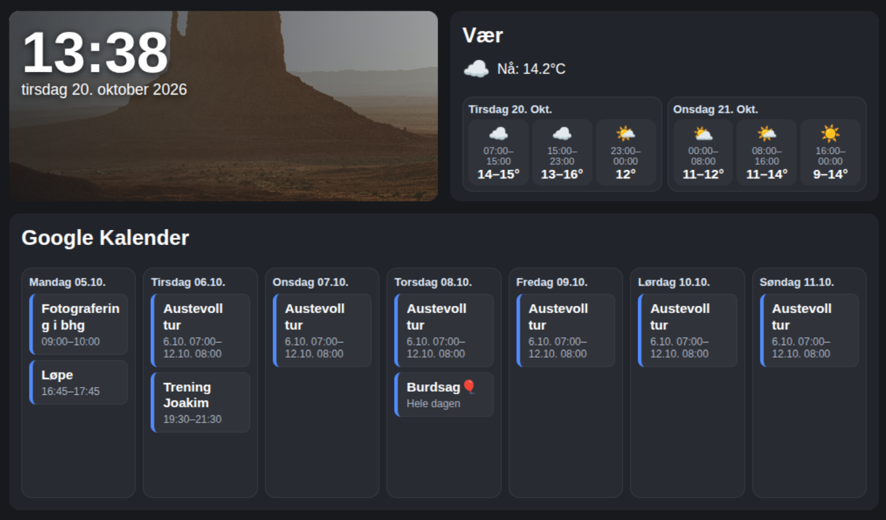

# Raspberry Pi 3 info screen
This is a personal setup that I use at home, with my Raspberry Pi 3 and my display with 1024x600, to get some info we need on a day-to-day basis.
Dashboard refresh interval is 1 minute



### Prerequisites
### Rust and Cargo
Install Rust/Cargo with [rustup](https://rust-lang.org/tools/install/) if needed. The minimum Rust version is **1.98.0**, as declared in `Cargo.toml`.

Verify Rust and Cargo are installed:

```bash
rustc --version
cargo --version
```

#### One-time Google Calendar setup
For Google Calendar:
1. Create a Google Cloud project.
2. Enable the Google Calendar API.
3. Configure the OAuth consent screen for the Calendar read-only scope (`https://www.googleapis.com/auth/calendar.readonly`) requested by `/api/oauth/google/config`.
4. Create an OAuth client of type **Web application**. No API key is used by this application.
5. Add `http://localhost:8080/oauth/callback` as an **authorized redirect URI**, not just `http://localhost:8080` as a JavaScript origin. If you override `GOOGLE_REDIRECT_URI`, register that exact URL instead; it must reach the application from the browser used for authorization.
6. Set `GOOGLE_CLIENT_ID` and `GOOGLE_CLIENT_SECRET` in the server environment, and set `CALENDAR_ID` to your calendar's ID (Google Calendar settings > Integrate calendar). The account you authorize must have read access to that calendar.
7. Start the application without `DEV_MODE=true` and open http://localhost:8080. The dashboard starts Google authorization when credentials are needed; the calendar authorization button can retry it.

The server exchanges the authorization code and saves the tokens to `GOOGLE_TOKEN_FILE`, reloading them on startup and refreshing expired access tokens when a refresh token is available. The process user must be able to write the token file and its parent directory. Keep this file private and outside version control; only the default `data/` directory is ignored by `.gitignore`.

#### Environment variables
Configuration is read at startup by `AppConfig::from_env` in `src/main.rs`. Export variables before `cargo run`, or use the systemd `Environment` entries below; restart the process after changes.

| Variable | Default / behavior |
| --- | --- |
| `GOOGLE_CLIENT_ID` | Unset; required for Google authorization. |
| `GOOGLE_CLIENT_SECRET` | Unset; required for Google authorization. Keep it on the server. |
| `GOOGLE_REDIRECT_URI` | `http://localhost:8080/oauth/callback`; must match the OAuth client's authorized redirect URI. |
| `CALENDAR_ID` | The hard-coded calendar ID in `src/main.rs`; set this to your own calendar ID. |
| `GOOGLE_TOKEN_FILE` | `data/google-oauth-token.json` when unset or blank. |
| `WEATHER_LATITUDE` | `58.14574000943632`; must be a finite number between -90 and 90. |
| `WEATHER_LONGITUDE` | `8.06137337891726`; must be a finite number between -180 and 180. Invalid coordinates prevent startup. |
| `SLIDESHOW_DIRECTORY` | `static/slideshow` when unset or blank; a missing directory produces an empty slideshow. |
| `SLIDESHOW_INTERVAL_SECONDS` | `30`; unset, invalid, or zero values fall back to 30 seconds. |
| `DEV_MODE` | Disabled unless the value is exactly `true`; uses the dashboard fixture instead of live weather and calendar requests. |

Relative paths are resolved from the process working directory. Slideshow images must be regular files directly inside the configured directory, with AVIF, GIF, JPEG/JPG, PNG, or WebP extensions.

### Build
Build the code without running it
```bash script
cargo build
```

#### Running the application locally in dev mode
Run from the repository root:

```bash script
DEV_MODE=true cargo run
```
Available at http://localhost:8080. In this mode, `/api/dashboard` reads `test-data/dashboard-response.json` and rebases its hourly weather dates to the current UTC date. Google credentials are not needed for the fixture dashboard; slideshow files and OAuth routes still use the normal configuration.

#### Tests
Run the same test command as `.github/workflows/build.yml`:

```bash
cargo test
```

### Run on startup Raspberry Pi 3
```bash script
sudo nano /etc/systemd/system/rust_app.service
```
and paste this content:

```
[Unit]
Description=My Rust Cargo Application
After=network.target

[Service]
Type=simple
User=joakim
WorkingDirectory=/home/joakim/git/priv/raspberry-pi-3-info-screen
Environment="GOOGLE_CLIENT_ID=your-client-id.apps.googleusercontent.com"
Environment="GOOGLE_CLIENT_SECRET=your-google-client-secret"
Environment="CALENDAR_ID=your-calendar-id"
Environment="WEATHER_LATITUDE=58.14574000943632"
Environment="WEATHER_LONGITUDE=8.06137337891726"
Environment="SLIDESHOW_DIRECTORY=/home/joakim/Bilder/info-screen"
Environment="SLIDESHOW_INTERVAL_SECONDS=30"
Environment="GOOGLE_TOKEN_FILE=/home/joakim/.local/state/info-screen/google-oauth-token.json"
ExecStart=/home/joakim/.cargo/bin/cargo run --release
Restart=on-failure

[Install]
WantedBy=multi-user.target
```
Replace the username, paths, credentials, calendar ID, and weather coordinates with your own values. The working directory must contain `Cargo.toml`; it also determines where relative slideshow and token paths resolve.

Then
```bash script
sudo systemctl daemon-reload
```
```bash script
sudo systemctl enable rust_app.service
```
```bash script
sudo systemctl start rust_app.service
```

Verify the Service Status
```bash script
sudo systemctl status rust_app.service
```

check logs
```bash script
journalctl -u rust_app.service -f
```

# Launch in kiosk mode on the Raspberry Pi 3
``` bash
firefox \
--kiosk \
http://localhost:8080
```
